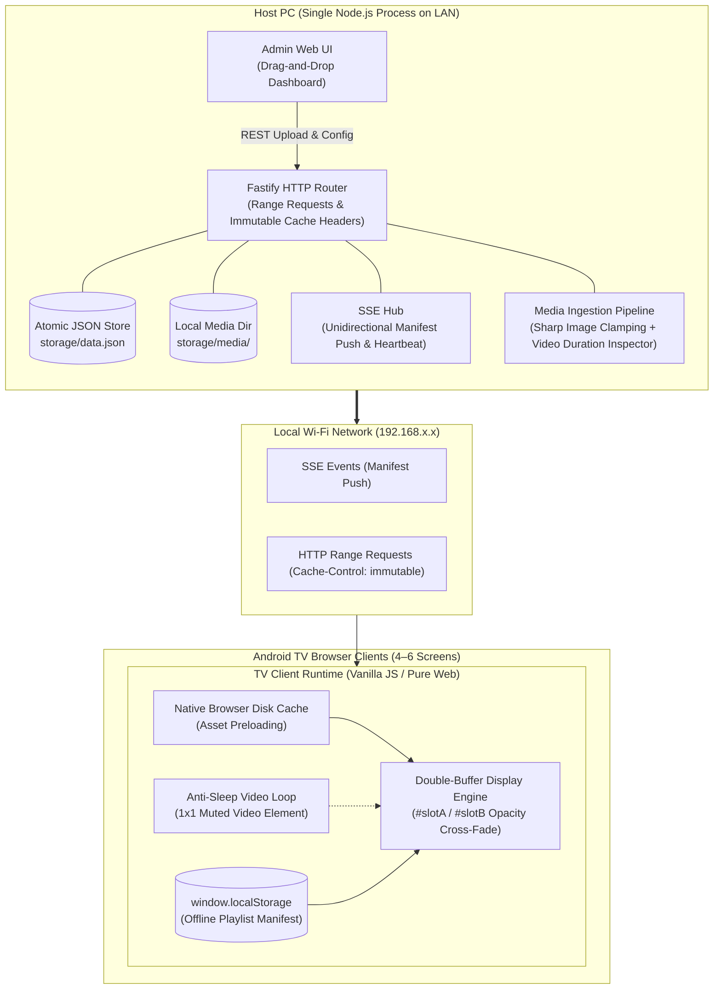

# Multi-Channel LAN Digital Signage System

*   **Author:** EGM System Designer
*   **Status:** Approved & Remediated
*   **Date:** 2026-11-11

--------------------------------------------------------------------------------

## Overview

The Multi-Channel LAN Digital Signage System provides a lightweight, local-network media distribution platform for managing independent digital signage channels across 4–6 Android TVs. The system is hosted on a single local PC and controlled entirely within a web browser, requiring zero cloud dependencies, external SaaS subscriptions, or native C++ compilation toolchains.

Operators manage content through a drag-and-drop administrative web interface, assigning playlists of JPEG/PNG image slides and 1080p MP4 videos to designated TV channels. Android TVs access their assigned channel through their built-in or Play Store TV web browser (e.g., *TV Bro*, *JioPages*, or Google Chrome). The client player executes an offline-resilient, pre-cached loop, ensuring continuous display even in the presence of Wi-Fi latency or host PC downtime.

## The Problem

Small to medium venues (e.g., retail spaces, clinics, restaurants, office floors) requiring 4–6 independent informational or advertising screens currently face two undesirable extremes:
1. **Commercial Cloud Signage Solutions**: These platforms require recurring monthly per-screen licensing fees, mandatory internet connectivity, and vendor-proprietary hardware dongles.
2. **Ad-Hoc Manual Playback (USB Sticks / HDMI Splitters)**: Manually updating USB flash drives across multiple rooms is labor-intensive and cannot be updated remotely. HDMI matrix splitters require expensive physical cabling and cannot show distinct content on individual screens without dedicated multi-head graphics cards.

Attempts to run simple web pages on consumer Smart TVs typically fail due to technical traps:
* **Insecure Context (HTTP) Barrier**: Modern Chromium engines disable `navigator.serviceWorker` and `navigator.wakeLock` on unencrypted remote LAN IPs (`http://192.168.x.x`), causing runtime crashes if code relies on PWA APIs without TLS.
* **Wi-Fi Saturation**: Streaming 4–6 independent 1080p video streams continuously overwhelms local Wi-Fi bandwidth.
* **Browser Memory Exhaustion**: TV web browsers crash after hours of continuous playback due to video decoder DOM memory leaks.
* **Screensaver Interruption**: Static slides trigger TV sleep or Daydream screensavers after 10–15 minutes.
* **Native Toolchain Compilation Friction**: Relying on native C++ SQLite addons (`better-sqlite3`) on Windows requires Visual Studio and Python, making deployment brittle.

The proposed solution addresses this by hosting a pure JavaScript Node.js service on an existing PC that serves pre-cached web channels with zero-touch looping, atomic JSON data storage, and a drag-and-drop web admin interface.

## Goals

*   **G1 - Multi-Channel Independent Playback**: Provide 6 distinct, isolated channels capable of playing independent looping playlists of JPEG/PNG slides and 1080p MP4 videos.
*   **G2 - Drag-and-Drop Content Ingestion**: Provide an in-browser management UI where operators can drag and drop media files directly onto channel playlist cards with instant client-side thumbnail previews and drag-to-reorder sorting.
*   **G3 - HTTP-Compliant Edge Caching**: Utilize standard browser HTTP disk caching (`Cache-Control: public, max-age=31536000, immutable`) and `localStorage` to persist media and manifests locally on each TV, preventing continuous Wi-Fi saturation without requiring Service Worker Secure Contexts.
*   **G4 - Memory-Safe Continuous Operation**: Implement a persistent dual-buffer DOM playback engine (`imgA`/`imgB`, `vidA`/`vidB`) with CSS opacity transitions and explicit decoder cleanup (`pause(); removeAttribute('src'); load()`), eliminating memory leaks across 12+ hours of continuous daily operation.
*   **G5 - Zero-Hardware & Zero-Root Friction**: Run entirely within standard web browsers on Android TV (e.g., *TV Bro*, *JioPages*, or Google Chrome) without requiring APK installation, sideloading, or device rooting.
*   **G6 - Display Sleep Suppression on HTTP**: Use an invisible, muted looping 1-second `<video>` element to keep Android TV screens awake continuously during static slide playback, bypassing Web WakeLock Secure Context restrictions.
*   **G7 - Offline & Disconnect Resilience**: Ensure TV displays continue looping their currently cached playlists uninterrupted if the host PC reboots or Wi-Fi drops.
*   **G8 - Zero Native C++ Toolchain Build**: Store channel and playlist metadata in an atomic JSON flat-file datastore, eliminating `better-sqlite3` and `node-gyp` Windows build errors.

## Non-Goals

*   **NG1 - Automated TV Hardware Power Control**: The system will not attempt hardware automation (Wake-on-LAN, IR blasters, or HDMI-CEC). Physical TV power-on and initial browser launch remain manual staff procedures.
*   **NG2 - Native Slide Document Parsing**: The server will not render raw PowerPoint (`.pptx`) or Keynote (`.key`) files on-the-fly. Slides must be pre-exported as JPEG or PNG images before uploading.
*   **NG3 - Synchronized Video Walls**: The system will not implement frame-accurate or audio-synchronized playback across multiple screens. Each screen operates as an independent playback timeline.
*   **NG4 - WAN / Cloud Remote Access**: The service operates strictly within the local area network (LAN). No public cloud relays or external WAN exposure are included in scope.
*   **NG5 - Complex Multi-User RBAC**: The admin dashboard is designed as a single-operator local tool with optional lightweight administrative PIN protection.

## Critical User Journeys (CUJs)

### CUJ 1: Operator Configures Channel Content via Drag-and-Drop
*   **Given**: The host PC is running the signage service on the local network (`http://192.168.1.50:8080/admin`).
*   **When**: An operator opens the admin URL in any desktop or mobile browser on the same LAN, drags 5 promotional JPEG images and 1 MP4 video directly onto "Channel 2", sets slide durations to 8 seconds each, and clicks "Save & Push".
*   **Then**: The server normalizes the images (clamping resolution to 1080p, resolving EXIF orientation), extracts MP4 video duration, saves the playlist atomically to `storage/data.json`, and broadcasts an update event via Server-Sent Events (SSE).

### CUJ 2: Morning Staff TV Activation & Seamless Playback
*   **Given**: TV 2 in Room B is powered off, and its browser has the bookmark for `http://192.168.1.50:8080/tv/2`.
*   **When**: A staff member turns on the TV using the remote control, opens the browser bookmark, and clicks "Start Channel".
*   **Then**: The TV player enters fullscreen, activates the background anti-sleep video loop, loads the cached playlist manifest from `localStorage`, and begins looping smoothly using the dual-buffer DOM engine without black screens between items.

### CUJ 3: Host PC Maintenance / Network Interruption
*   **Given**: 4 TVs are actively displaying playlists during operating hours.
*   **When**: The host PC unexpectedly restarts due to an operating system update, temporarily terminating the local web server for 10 minutes.
*   **Then**: The TV players detect the SSE disconnect, initiate silent exponential backoff reconnection attempts in the background, and continue looping the cached playlist from local browser disk cache with zero display disruption or error popups.

## Technical Plan (Architecture)

### 1. High-Level System Architecture



### 2. Component Design & Responsibilities

#### A. Host Server (Node.js & Fastify)
*   **HTTP Engine**: Fastify server bound to `0.0.0.0:8080`, supporting byte-range partial content requests (`Accept-Ranges: bytes`) via `@fastify/static`. Media assets are served with `Cache-Control: public, max-age=31536000, immutable`.
*   **Real-time Push Hub**: Unidirectional Server-Sent Events (`EventSource`) per channel (`/api/channels/:id/events`). Includes a 30-second keep-alive ping and tracks active client connections.
*   **Media Processing Pipeline**:
    *   Direct multi-file upload handling via `@fastify/multipart` (configured with a 500MB max file size limit).
    *   Image normalization using `sharp`: auto-rotates EXIF orientation and downsamples oversized images to 1920x1080 sRGB.
    *   Video metadata inspection using `music-metadata`: extracts container format, H.264 profile, dimensions, and playback duration in seconds.
    *   Deterministic content-addressed storage: files are stored as `storage/media/[sha256_16char].[ext]`, guaranteeing deduplication across all channels.
    *   Orphaned media garbage collection: unlinks unreferenced media files from disk upon playlist saves.
*   **Atomic JSON Data Store**: Single file `storage/data.json` managed via `src/db.js` using atomic rename (`write to .tmp -> rename`). Pre-populates 6 default channels (`"Channel 1"` to `"Channel 6"`).

#### B. Administrative Dashboard (Web SPA)
*   **Direct Drag-and-Drop Ingestion**: Native HTML5 Drag and Drop API implemented over channel cards. Dropping files directly initiates streaming multipart upload with browser progress bars.
*   **Client-Side Thumbnails & Visual Reordering**: Images generate instant previews via `URL.createObjectURL`. Video cards generate client-side thumbnail snapshots via a temporary `<video>` + `<canvas>`. Draggable cards allow intuitive reordering.
*   **Inline Timing Controls**: Each static slide card contains an inline numerical duration input (seconds, minimum 3s, default 10s). Video cards display detected playback duration as read-only.
*   **Live Channel Monitor**: Displays connection health (Online/Offline based on active server SSE connections and last heartbeat).

#### C. Android TV Player Engine (Vanilla HTML5 / JavaScript)
*   **Dual-Buffer DOM Architecture**: The player maintains four DOM nodes inside a zero-chrome viewport (`width: 100vw; height: 100vh; overflow: hidden; background: #000; cursor: none; position: fixed;`):
    *   Two image elements (`#imgA`, `#imgB`)
    *   Two video elements (`#vidA`, `#vidB`, initialized with `muted playsinline`)
*   **Transition Mechanics**: While Slot A is displayed (`opacity: 1`), Slot B preloads the subsequent asset (`opacity: 0`). When the timer expires or the video `ended` event fires, Slot B transitions to `opacity: 1`, Slot A fades to `opacity: 0`, and Slot A's video decoder is cleanly torn down (`video.pause(); video.removeAttribute('src'); video.load()`).
*   **Native HTTP Disk Caching**: On receiving an updated manifest, the player pre-fetches all asset URLs into the browser's native HTTP disk cache via standard `fetch()`. Because assets have immutable cache headers, subsequent playback loads directly from local disk cache with 0 bps network usage.
*   **Anti-Sleep Video Loop**: A hidden 1x1 pixel muted looping video (`assets/keepalive.mp4`) runs in the background to suppress Android TV screensaver and sleep modes without requiring the Web WakeLock API.

### 3. Concrete REST & SSE Wire Contracts

#### `GET /api/channels`
*   **Status:** `200 OK`
*   **Response Schema:**
    ```json
    [
      {
        "id": 1,
        "name": "Channel 1",
        "resolution": "1920x1080",
        "item_count": 5,
        "total_duration": 58.0,
        "online": true
      }
    ]
    ```

#### `GET /api/channels/:id`
*   **Status:** `200 OK` (or `404 Not Found`)
*   **Response Schema:**
    ```json
    {
      "id": 1,
      "name": "Channel 1",
      "resolution": "1920x1080",
      "items": [
        {
          "id": "item_1",
          "asset_id": "a1b2c3d4e5f67890",
          "url": "/media/a1b2c3d4e5f67890.jpg",
          "original_name": "menu_slide.jpg",
          "mime_type": "image/jpeg",
          "duration": 10.0,
          "order": 0
        }
      ]
    }
    ```

#### `POST /api/channels/:id/playlist`
*   **Request Schema:**
    ```json
    {
      "items": [
        { "asset_id": "a1b2c3d4e5f67890", "duration": 10.0, "order": 0 },
        { "asset_id": "f0e1d2c3b4a56789", "duration": 34.5, "order": 1 }
      ]
    }
    ```
*   **Status:** `200 OK` (or `400 Bad Request`)

#### `POST /api/media/upload`
*   **Request:** `multipart/form-data` with field `file`.
*   **Status:** `201 Created`
*   **Response Schema:**
    ```json
    {
      "asset_id": "a1b2c3d4e5f67890",
      "filename": "a1b2c3d4e5f67890.jpg",
      "original_name": "promo.jpg",
      "url": "/media/a1b2c3d4e5f67890.jpg",
      "mime_type": "image/jpeg",
      "byte_size": 245120,
      "width": 1920,
      "height": 1080,
      "duration": 10.0
    }
    ```

#### Server-Sent Events (`GET /api/channels/:id/events`)
*   **`event: playlist_update`**:
    ```json
    {
      "channel_id": 1,
      "version": 1715412345,
      "items": [
        {
          "asset_id": "a1b2c3d4e5f67890",
          "url": "/media/a1b2c3d4e5f67890.jpg",
          "mime_type": "image/jpeg",
          "duration": 10.0
        }
      ]
    }
    ```
*   **`event: ping`**: `{ "timestamp": 1715412375 }` (sent every 30 seconds).

## Detailed Implementation

### 1. Unified Implementation Task List

1.  **Project Initialization & Dependencies Setup**:
    *   Initialize `package.json` with `"type": "module"`, `"engines": { "node": ">=20.0.0" }`.
    *   Install runtime dependencies: `fastify`, `@fastify/static`, `@fastify/multipart`, `@fastify/cors`, `sharp`, `music-metadata`.
    *   Install dev/test dependencies: `node:test` (built-in).
    *   Create `.gitignore` tracking `node_modules/`, `storage/media/`, and temporary build artifacts.
2.  **Atomic JSON Flat-Store & Channel Seeding**:
    *   Implement `src/db.js` providing atomic read/write for `storage/data.json` with temporary file swapping.
    *   Seed default configuration for Channels 1 through 6.
3.  **Media Processing & Video Metadata Ingestion Pipeline**:
    *   Implement `src/media.js` supporting image normalization via `sharp` (EXIF orientation auto-correction and 1080p bounding) and video metadata extraction via `music-metadata` (duration, container, width, height).
    *   Implement content-addressed SHA-256 file hashing (`storage/media/[hash].[ext]`) and unreferenced media garbage collection.
4.  **Real-Time Server-Sent Events (SSE) Hub**:
    *   Implement `src/sse.js` managing client SSE connections per channel, broadcasting `playlist_update` manifests, and sending 30s keep-alive pings.
5.  **REST API Routing & Static File Delivery**:
    *   Implement API controllers in `src/routes/api.js` for channel listing, channel playlist saving, and multipart file uploading.
    *   Configure Fastify server (`src/server.js`) serving static media with HTTP 206 byte-ranges, immutable cache headers, and local network IP console logging.
6.  **Administrative Dashboard UI**:
    *   Construct layout (`public/admin/index.html` and `public/admin/style.css`) with 6 channel cards, file dropzones, and status monitors.
    *   Implement client logic (`public/admin/admin.js`) for HTML5 drag-and-drop file ingestion, client-side thumbnail generation, drag-to-reorder cards, and REST synchronization.
7.  **Android TV Player Engine**:
    *   Construct TV display shell (`public/tv/index.html` and `public/tv/style.css`) with zero-chrome CSS, dual-buffer containers, and initial click-to-start splash screen.
    *   Implement player controller (`public/tv/player.js`) managing opacity cross-fading, `localStorage` manifest hydration, SSE event consumption, and hidden video anti-sleep loop.
8.  **Windows Startup Script**:
    *   Create `scripts/start.bat` that launches `npm start` and automatically opens the admin interface in the default browser.
9.  **Verification Harness & Automated Test Suite**:
    *   Implement unit and integration tests using `node:test`:
        *   `tests/data.test.js`: Validates atomic reads, writes, and default channel seeding.
        *   `tests/media.test.js`: Validates image normalization and video duration extraction.
        *   `tests/api.test.js`: Validates REST endpoints, range requests, and SSE headers.
10. **Operator Manual & Documentation**:
    *   Write `README.md` covering setup instructions, TV browser recommendations (*TV Bro*, Chrome), bookmarking procedures, and troubleshooting.

### 2. Complete File Manifest

| File Path | Operation | Component | Rationale & Responsibility |
| :--- | :--- | :--- | :--- |
| `package.json` | Create | Infrastructure | Project manifest declaring pure JS dependencies (`fastify`, `sharp`, `music-metadata`) and npm scripts. |
| `.gitignore` | Create | Infrastructure | Excludes `node_modules/`, `storage/media/`, and `.tmp` files from version control. |
| `src/server.js` | Create | Host Backend | Main server entry point; binds to `0.0.0.0:8080`, configures Fastify static routes, CORS, and logs local LAN IP. |
| `src/db.js` | Create | Host Backend | Atomic JSON flat-file datastore managing `storage/data.json` without native C++ compilation. |
| `src/media.js` | Create | Host Backend | Ingestion engine normalizing images via `sharp` and extracting video durations via `music-metadata`. |
| `src/sse.js` | Create | Host Backend | SSE broadcasting hub managing channel streams, active client tracking, and keep-alive pings. |
| `src/routes/api.js` | Create | Host Backend | REST API endpoints for channel status, playlist updates, and multipart file uploads. |
| `public/admin/index.html` | Create | Admin UI | HTML layout for the admin dashboard displaying channel cards, upload dropzones, and status monitors. |
| `public/admin/style.css` | Create | Admin UI | Dark-mode styles for the administration dashboard, grid card layouts, and drag-and-drop visual states. |
| `public/admin/admin.js` | Create | Admin UI | Admin JavaScript logic; handles HTML5 drag-and-drop events, thumbnail previews, drag-to-reorder playlist management, and REST synchronization. |
| `public/tv/index.html` | Create | TV Player | Minimalist HTML shell for the TV display; contains dual-buffer display containers (`#slotA`, `#slotB`) and the user-gesture splash screen. |
| `public/tv/style.css` | Create | TV Player | Zero-chrome CSS enforcing fixed 100vw/100vh viewport, black background, hidden cursor, and hardware-accelerated opacity transitions. |
| `public/tv/player.js` | Create | TV Player | Core playback engine; controls dual-buffer DOM element swapping, SSE event handling, playlist progression, and anti-sleep loop. |
| `public/assets/keepalive.mp4`| Create | TV Player | Minimal 1x1 muted looping video to prevent TV screensavers over plain HTTP without Web WakeLock. |
| `scripts/start.bat` | Create | Operations | Windows batch script to start the server and open `http://localhost:8080/admin`. |
| `tests/data.test.js` | Create | Testing | Tests atomic JSON store reads, writes, and initial channel seeding. |
| `tests/media.test.js` | Create | Testing | Tests image clamping, EXIF orientation, and content hashing. |
| `tests/api.test.js` | Create | Testing | Tests Fastify REST routes, upload handling, and SSE streaming. |
| `README.md` | Create | Documentation | Operator manual covering installation, TV browser recommendations (*TV Bro*), bookmarking procedures, and troubleshooting. |
