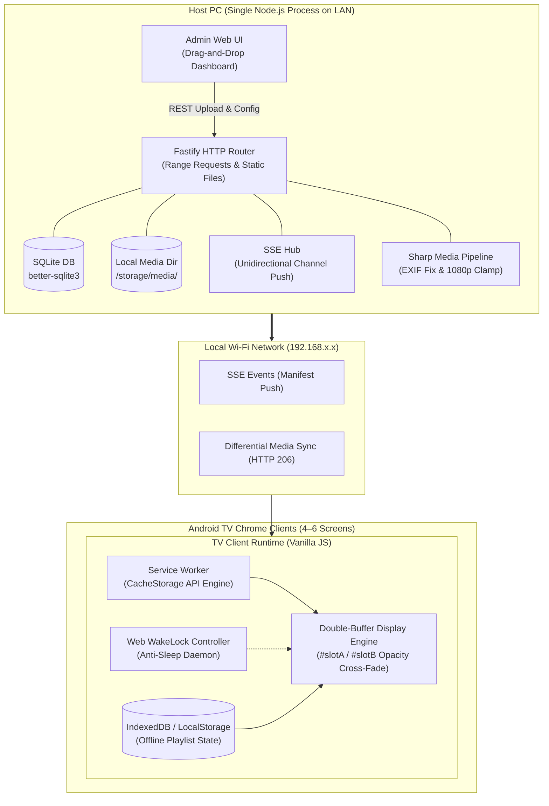

# Multi-Channel LAN Digital Signage System

*   **Author:** EGM System Designer
*   **Status:** Draft
*   **Date:** 2026-11-11

--------------------------------------------------------------------------------

## Overview

The Multi-Channel LAN Digital Signage System provides a lightweight, local-network media distribution platform for managing independent digital signage channels across 4–6 Android TVs. The system is hosted on a single local PC and controlled entirely within a web browser, requiring zero cloud dependencies or external SaaS subscriptions.

Operators manage content through a drag-and-drop administrative web interface, assigning playlists of JPEG image slides and 1080p MP4 videos to designated TV channels. Android TVs access their assigned channel through their built-in Google Chrome browser. The client player executes an offline-resilient, pre-cached loop, ensuring smooth continuous display even in the presence of Wi-Fi latency or host PC downtime.

## The Problem

Small to medium venues (e.g., retail spaces, clinics, restaurants, office floors) requiring 4–6 independent informational or advertising screens currently face two undesirable extremes:
1. **Commercial Cloud Signage Solutions**: These platforms require recurring monthly per-screen licensing fees, mandatory internet connectivity, and vendor-proprietary hardware dongles.
2. **Ad-Hoc Manual Playback (USB Sticks / HDMI Splitters)**: Manually updating USB flash drives across multiple rooms is labor-intensive and cannot be updated remotely. HDMI matrix splitters require expensive physical cabling and cannot show distinct content on individual screens without dedicated multi-head graphics cards.

Attempts to run simple web pages on consumer Smart TVs typically fail due to technical traps:
* **Wi-Fi Saturation**: Streaming 4–6 independent 1080p video streams continuously overwhelms local Wi-Fi bandwidth.
* **Browser Memory Exhaustion**: TV web browsers crash after hours of continuous playback due to video decoder DOM memory leaks.
* **Screensaver Interruption**: Static slides trigger TV sleep or Daydream screensavers after 10–15 minutes.
* **Complex Staff Operation**: Requiring staff to manage device pairing, SSH, or complex TV apps creates high operational friction.

The proposed solution addresses this by hosting a local Node.js service on an existing PC that serves pre-cached web channels to native TV browsers with zero-touch looping and a drag-and-drop web admin interface.

## Goals

*   **G1 - Multi-Channel Independent Playback**: Provide 4–6 distinct, isolated channels capable of playing independent looping playlists of JPEG slides and 1080p MP4 videos.
*   **G2 - Drag-and-Drop Content Ingestion**: Provide an in-browser management UI where operators can drag and drop media files directly onto channel playlist cards with instant client-side thumbnail previews and drag-to-reorder sorting.
*   **G3 - Bandwidth-Efficient Edge Caching**: Utilize the browser Cache Storage API and a Service Worker on each TV to prefetch media assets, running ongoing playback loops entirely from local storage to prevent continuous Wi-Fi saturation.
*   **G4 - Memory-Safe Continuous Operation**: Implement a persistent dual-buffer DOM playback engine (`imgA`/`imgB`, `vidA`/`vidB`) with CSS opacity transitions, eliminating memory leaks and black-screen flashes across 12+ hours of continuous daily operation.
*   **G5 - Zero-Hardware Friction on Client**: Run entirely within the existing Google Chrome browser on Android TV without requiring APK installation, sideloading, or device rooting.
*   **G6 - Display Power & Sleep Prevention**: Acquire and maintain a Screen WakeLock via the Web API to suppress Android TV sleep and Daydream screensavers during slide playback.
*   **G7 - Offline & Disconnect Resilience**: Ensure TV displays continue looping their currently cached playlists uninterrupted if the host PC reboots or Wi-Fi drops.

## Non-Goals

*   **NG1 - Automated TV Hardware Control**: The system will not attempt hardware automation (Wake-on-LAN, IR blasters, or HDMI-CEC). Physical TV power-on and initial browser launch remain manual staff procedures.
*   **NG2 - Native Slide Document Parsing**: The server will not render raw PowerPoint (`.pptx`) or Keynote (`.key`) files on-the-fly. Slides must be pre-exported as JPEG or PNG images before uploading.
*   **NG3 - Synchronized Video Walls**: The system will not implement frame-accurate or audio-synchronized playback across multiple screens. Each screen operates as an independent playback timeline.
*   **NG4 - WAN / Cloud Remote Access**: The service operates strictly within the local area network (LAN). No public cloud relays, user account federation, or external WAN exposure are included in scope.
*   **NG5 - Complex Multi-User RBAC**: The admin dashboard is designed as a single-operator local tool without role-based access control or audit logging.

## Open Questions

*   **OQ1**: What maximum total file storage limit should be enforced per channel to prevent exhausting the Android TV internal flash storage cache? (Baseline recommendation: 2GB per TV client).
*   **OQ2**: Should video audio be muted by default on all screens, or is unmuted audio required on specific TV channels (which requires staff interaction on the TV remote to satisfy browser autoplay policies)?

## Critical User Journeys (CUJs)

### CUJ 1: Operator Configures Channel Content via Drag-and-Drop
*   **Given**: The host PC is running the signage service on the local network (e.g., `http://192.168.1.50:8080/admin`).
*   **When**: An operator opens the admin URL in any desktop or mobile browser on the same LAN, drags 5 promotional JPEG images and 1 MP4 video directly onto "Channel 2", sets slide durations to 8 seconds each, and clicks "Save & Push".
*   **Then**: The server normalizes the images (clamping resolution to 1080p, resolving EXIF orientation), saves the playlist, and broadcasts an update event via Server-Sent Events (SSE).

### CUJ 2: Morning Staff TV Activation & Seamless Playback
*   **Given**: TV 2 in Room B is powered off, and its browser has the bookmark for `http://192.168.1.50:8080/tv/2`.
*   **When**: A staff member turns on the TV using the remote control, opens the Chrome bookmark, and presses the center remote button on the initial "Start Channel" prompt.
*   **Then**: The TV player enters fullscreen, acquires a Screen WakeLock, prefetches any newly added media into local cache, and begins looping the playlist smoothly using the dual-buffer DOM engine without black screens between items.

### CUJ 3: Host PC Maintenance / Network Interruption
*   **Given**: 4 TVs are actively displaying playlists during operating hours.
*   **When**: The host PC unexpectedly restarts due to an operating system update, temporarily terminating the local web server for 10 minutes.
*   **Then**: The TV players detect the SSE disconnect, initiate silent exponential backoff reconnection attempts in the background, and continue looping the cached playlist from local Cache Storage with zero display disruption or error popups.

## Technical Plan (Architecture)

### 1. High-Level System Architecture

### 2. Component Design & Responsibilities

#### A. Host Server (Node.js & Fastify)
*   **HTTP Engine**: Fastify server bound to `0.0.0.0:8080`, supporting byte-range partial content requests (`Accept-Ranges: bytes`) via `@fastify/static`. This enables smooth browser video buffering and decoder hardware acceleration.
*   **Real-time Push Hub**: Unidirectional Server-Sent Events (`EventSource`) per channel (`/api/channels/:id/events`). Eliminates the state overhead of bi-directional WebSockets while providing automatic browser client reconnection.
*   **Media Processing Pipeline**:
    *   Direct multi-file upload handling via `@fastify/multipart`.
    *   JPEG/PNG normalization using `sharp`: extracts EXIF rotation metadata, auto-rotates to upright orientation, and rescales oversized images to a bounding box of 1920x1080 pixels (sRGB), reducing memory footprint on the TV clients.
    *   Asset storage naming uses content hashing (`[timestamp]_[sha256_short].[ext]`) to guarantee HTTP cache-busting and prevent name collision.
*   **Metadata Storage**: SQLite using `better-sqlite3` (single-file database `signage.db` with WAL mode enabled). Schema stores:
    *   `channels`: ID (1–6), name, resolution target.
    *   `media_assets`: ID, file name, original name, mime type, byte size, width, height, duration_seconds.
    *   `playlist_items`: ID, channel_id, asset_id, sequence_order, display_duration_seconds.

#### B. Administrative Dashboard (Web SPA)
*   **Direct Drag-and-Drop Ingestion**: Native HTML5 Drag and Drop API implemented over channel cards. Dropping files directly initiates chunked upload with instant progress bars.
*   **Thumbnail Previews & Visual Reordering**: Dropped assets immediately render draggable thumbnail cards. Users reorder sequence via pointer drag; updates update `sequence_order` in real-time.
*   **Inline Timing Controls**: Each static slide card contains an inline numerical duration input (seconds, minimum 3s, default 10s). Video cards display detected playback duration as read-only.
*   **Live Channel Monitor**: Dashboard displays heartbeats for all 4–6 screens (Connected/Offline, currently playing asset index, cache status).

#### C. Android TV Player Engine (Vanilla HTML5 / JavaScript)
*   **Dual-Buffer DOM Architecture**: The player maintains exactly four DOM nodes in a fixed viewport (`width: 100vw; height: 100vh; overflow: hidden; background: #000; cursor: none;`):
    *   `#imgA` and `#imgB` (for image slides).
    *   `#vidA` and `#vidB` (for MP4 videos, initialized with `muted playsinline`).
*   **Transition Mechanics**: While Slot A is displayed (`opacity: 1`), Slot B preloads the subsequent asset (`opacity: 0`). When the slide duration timer expires or the video emits the `ended` event, Slot B transitions to `opacity: 1` over 400ms, Slot A fades to `opacity: 0`, and Slot A's source is cleared (`src = ""`) to release GPU texture buffers.
*   **Service Worker Edge Caching**:
    *   On receiving a `playlist_update` event via SSE, the Service Worker inspects the new manifest, compares asset hashes against `CacheStorage`, and downloads missing media in the background.
    *   Once all assets are cached locally, the player switches to the new playlist at the end of the current playing item ("Soft Sync").
    *   Ongoing playback fetches from `CacheStorage` via the Service Worker fetch event listener, guaranteeing 0 bps network usage during normal looping.
*   **Screen WakeLock Controller**: Upon user tap on the initial boot splash screen, the player calls `navigator.wakeLock.request('screen')`. A visibility change listener automatically re-acquires the lock if the browser tab loses and regains focus.

### 3. API & Event Specifications

#### REST Endpoints
*   `GET /api/channels`: Returns metadata and active playlists for all 6 channels.
*   `GET /api/channels/:id`: Returns playlist items, media URLs, and display durations for channel `:id`.
*   `POST /api/channels/:id/playlist`: Replaces channel playlist items.
*   `POST /api/media/upload`: Accepts `multipart/form-data` file uploads. Returns asset metadata and generated thumbnail URL.
*   `GET /media/:filename`: Serves static media with `Accept-Ranges: bytes` support and `Cache-Control: public, max-age=31536000, immutable`.
*   `GET /tv/:id`: Serves the TV client HTML player.
*   `GET /admin`: Serves the administrative control panel.

#### Server-Sent Events (`GET /api/channels/:id/events`)
*   `event: playlist_update`: Pushes updated playlist manifest containing file URLs and durations.
*   `event: force_reload`: Instructs TV client to purge cache and reload immediately.
*   `event: ping`: Sent every 30 seconds to keep TCP connection alive across router NAT tables.

## Alternatives Considered

### Alternative 1: Continuous Direct HTTP/HLS Video Streaming
*   **Mechanism**: The TV player connects directly to the host server on every loop iteration, streaming video chunks over HTTP or HLS without client disk caching.
*   **Pros**:
    *   Simpler client JavaScript without Service Worker or CacheStorage API logic.
    *   Instant content changes without waiting for client pre-caching.
*   **Cons**:
    *   Consumes 40–90 Mbps of continuous Wi-Fi airtime across 4–6 screens, leading to radio interference, dropped frames, and video stuttering.
    *   Displays fail immediately if the host PC restarts or the Wi-Fi connection drops.
*   **Reason for Rejection**: High failure rate in real-world multi-room consumer Wi-Fi environments and zero offline resilience.

### Alternative 2: Dedicated Native Android TV Application (APK / Sideloading)
*   **Mechanism**: Developing a native Android application (Kotlin or Flutter) installed directly on each TV, configured to run as an Android home/kiosk launcher with boot receiver.
*   **Pros**:
    *   Native hardware auto-start on TV power-on without requiring manual Chrome launching.
    *   Direct ExoPlayer hardware-accelerated video decoding.
*   **Cons**:
    *   Requires enabling Android Developer Options, ADB over Wi-Fi/USB, and manual APK sideloading across all 6 physical TVs.
    *   Substantially increases setup friction, maintenance overhead, and OS version incompatibility across diverse TV brands.
*   **Reason for Rejection**: Violates the core operational constraint requiring simple, immediate browser-based access without device modification or technical staff installation.

### Alternative 3: Bi-Directional WebSockets vs. Server-Sent Events (SSE)
*   **Mechanism**: Establishing full-duplex WebSocket connections between the host PC and all TV clients for command dispatch and telemetry.
*   **Pros**:
    *   Provides two-way communication over a single TCP connection.
*   **Cons**:
    *   Requires custom ping/pong framing, manual reconnection backoff logic, and complex server connection tracking.
    *   Overkill for what is strictly a unidirectional push of playlist manifests from host to TV.
*   **Reason for Rejection**: Server-Sent Events (SSE) provides native automatic reconnection, standard HTTP semantics, proxy friendliness, and smaller client footprint.

### Alternative 4: Full-Featured Open-Source Signage Platform (Anthias / Xibo)
*   **Mechanism**: Deploying an existing open-source digital signage platform (e.g., Anthias, Xibo, LibreSignage) on the host PC.
*   **Pros**:
    *   Mature existing codebases with rich enterprise scheduling features.
*   **Cons**:
    *   Expects dedicated hardware player appliances (e.g., Raspberry Pi) or complex multi-container Docker/PHP stacks that are cumbersome to install, run, and maintain on a standard Windows PC.
    *   Excessive complexity (RBAC, campaign rules, transition effects) far beyond the focused requirement of a local drag-and-drop playlist looper.
*   **Reason for Rejection**: Violates the YAGNI principle; introduces unnecessary deployment overhead and maintenance surface.

## Detailed Implementation

### 1. Unified Implementation Task List

1.  **Project Initialization & Dependencies Setup**:
    *   Initialize Node.js package environment (`package.json`) configuring ES Modules (`type: "module"`).
    *   Install production dependencies: `fastify`, `@fastify/static`, `@fastify/multipart`, `@fastify/cors`, `better-sqlite3`, and `sharp`.
2.  **Database & Schema Initialization**:
    *   Implement SQLite connection manager and migration script (`src/db.js`).
    *   Create tables: `channels`, `media_assets`, and `playlist_items`. Pre-populate default records for Channels 1 through 6.
3.  **Media Processing & File Storage Pipeline**:
    *   Implement upload processor (`src/media.js`) to handle multipart streams, generate content-addressed hashes, normalize images via `sharp` (EXIF orientation auto-correction and bounding to 1920x1080), and save media to `/storage/media/`.
4.  **Real-Time Server-Sent Events (SSE) Hub**:
    *   Implement channel event broadcaster (`src/sse.js`) supporting client subscription (`/api/channels/:id/events`), keep-alive heartbeats, and playlist update pushes.
5.  **REST API Routing & Static File Delivery**:
    *   Implement API endpoints (`src/routes/api.js`) for channel management, playlist ordering, and file uploads.
    *   Configure Fastify server (`src/server.js`) with static asset streaming supporting HTTP 206 byte-ranges.
6.  **Administrative Dashboard UI**:
    *   Construct single-page layout (`public/admin/index.html` and `public/admin/style.css`) with 6 channel panels.
    *   Implement client logic (`public/admin/admin.js`) providing native HTML5 drag-and-drop ingestion, client-side thumbnail rendering, drag-to-reorder sorting, inline duration controls, and REST calls.
7.  **Android TV Player Engine**:
    *   Construct player shell (`public/tv/index.html` and `public/tv/style.css`) with zero-chrome CSS, dual-buffer containers, and initial touch/click splash screen.
    *   Implement player controller (`public/tv/player.js`) managing opacity cross-fading, SSE event consumption, state recovery, and Screen WakeLock requests.
8.  **Service Worker Edge Caching**:
    *   Implement Service Worker (`public/tv/sw.js`) to intercept `/media/*` requests and manage CacheStorage retention for offline looping.
9.  **Deployment & Staff Ergonomics**:
    *   Create Windows one-click launcher script (`scripts/start.bat`) that prints local IP and opens the admin interface.
    *   Write user manual (`README.md`) covering TV bookmarking instructions and router configuration recommendations.

### 2. Complete File Manifest & Rationale

| File Path | Operation | Component | Rationale & Responsibility |
| :--- | :--- | :--- | :--- |
| `package.json` | Create | Infrastructure | Project manifest declaring Node.js dependencies (`fastify`, `sharp`, `better-sqlite3`, etc.) and start scripts. |
| `src/server.js` | Create | Host Backend | Main server entry point; binds to `0.0.0.0:8080`, registers Fastify plugins, CORS, static routes with byte ranges, and initiates shutdown handlers. |
| `src/db.js` | Create | Host Backend | SQLite database manager; initializes `signage.db` in WAL mode, creates tables (`channels`, `media_assets`, `playlist_items`), and seeds 6 default channels. |
| `src/media.js` | Create | Host Backend | Media ingestion service; validates uploads, invokes `sharp` for EXIF orientation correction and 1080p downsampling, and stores files using content hashes. |
| `src/sse.js` | Create | Host Backend | SSE broadcasting hub; manages client channels, broadcasts `playlist_update` events, and sends 30s keepalive pings to keep NAT tables active. |
| `src/routes/api.js` | Create | Host Backend | REST API endpoints for channel status, playlist CRUD, and multipart file upload handling. |
| `public/admin/index.html` | Create | Admin UI | HTML layout for the admin dashboard displaying channel cards, upload dropzones, and status monitors. |
| `public/admin/style.css` | Create | Admin UI | Dark-mode styles for the administration dashboard, grid card layouts, and drag-and-drop visual states. |
| `public/admin/admin.js` | Create | Admin UI | Admin JavaScript logic; handles HTML5 drag-and-drop events, thumbnail previews, drag-to-reorder playlist management, and REST synchronization. |
| `public/tv/index.html` | Create | TV Player | Minimalist HTML shell for the TV display; contains dual-buffer display containers (`#slotA`, `#slotB`) and the user-gesture splash screen. |
| `public/tv/style.css` | Create | TV Player | Zero-chrome CSS enforcing fixed 100vw/100vh viewport, black background, hidden cursor, and hardware-accelerated opacity transitions. |
| `public/tv/player.js` | Create | TV Player | Core playback engine; controls dual-buffer DOM element swapping, SSE event handling, playlist progression, and Screen WakeLock. |
| `public/tv/sw.js` | Create | TV Player | Service Worker script; caches media files in `CacheStorage`, enabling 100% offline continuous looping and zero continuous Wi-Fi usage. |
| `scripts/start.bat` | Create | Operations | Windows batch script to detect the local IPv4 address, launch the Node server, and open the default browser to `http://localhost:8080/admin`. |
| `README.md` | Create | Documentation | Operator manual covering installation, TV Chrome bookmarking procedures, IP configuration, and troubleshooting. |
